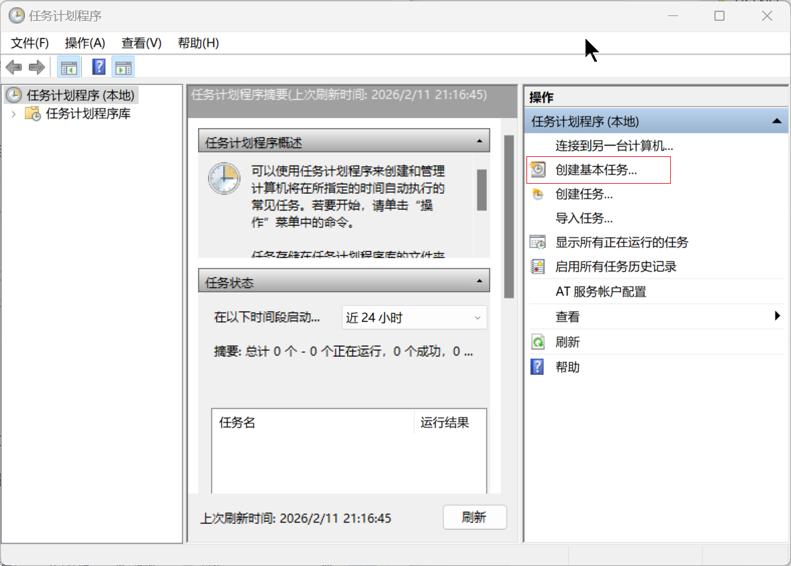
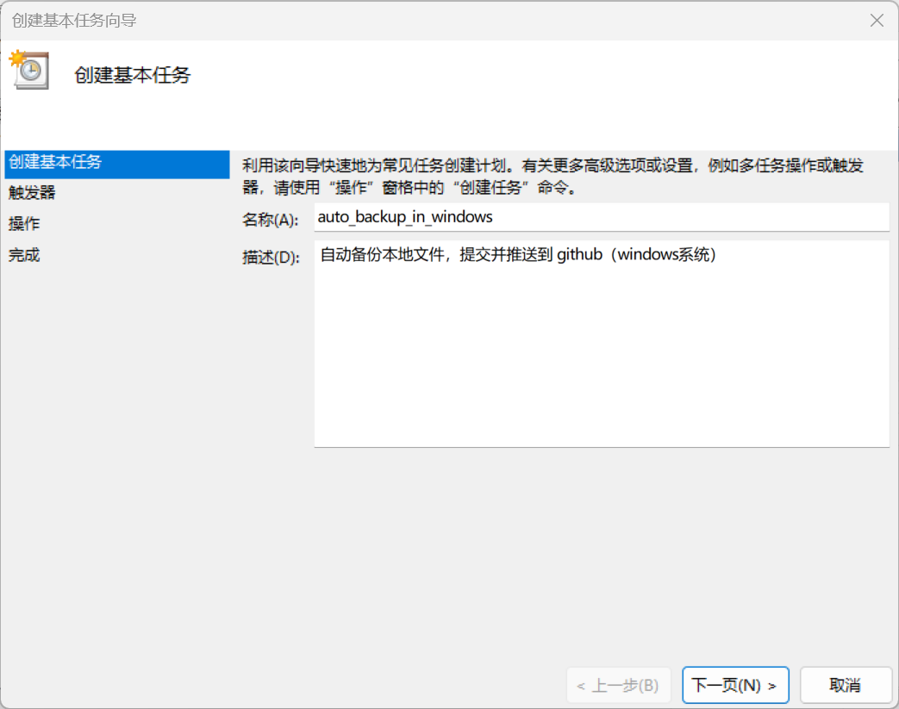
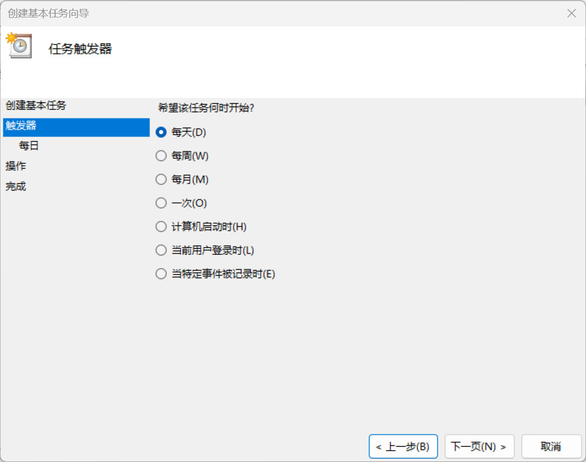
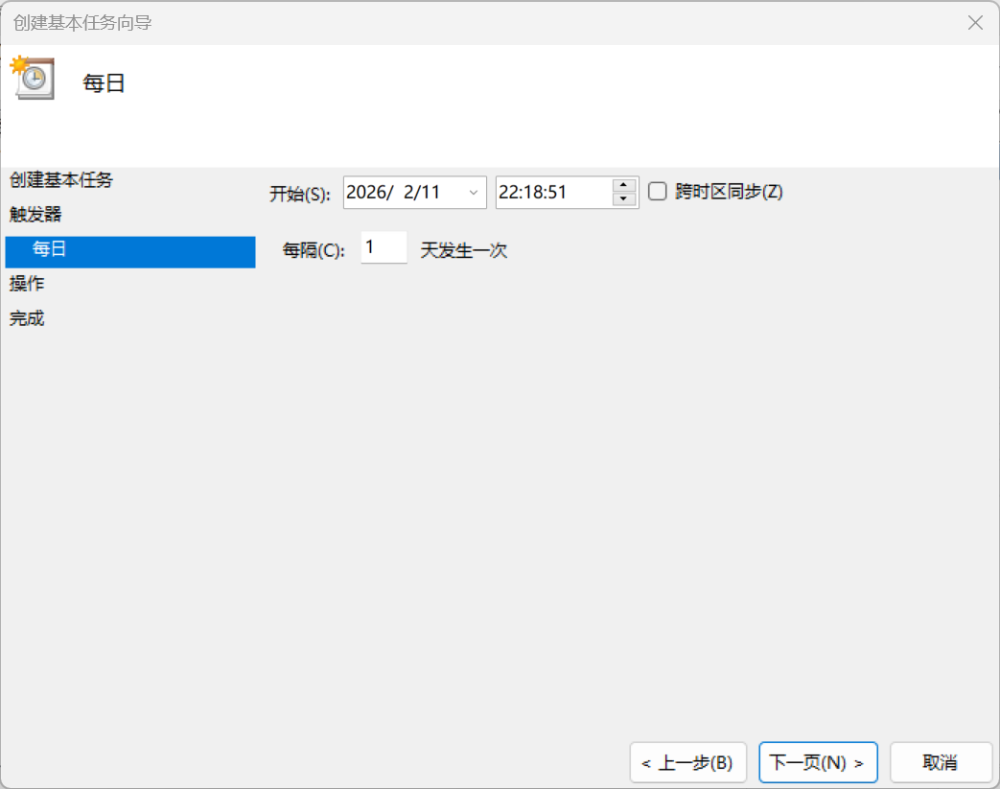
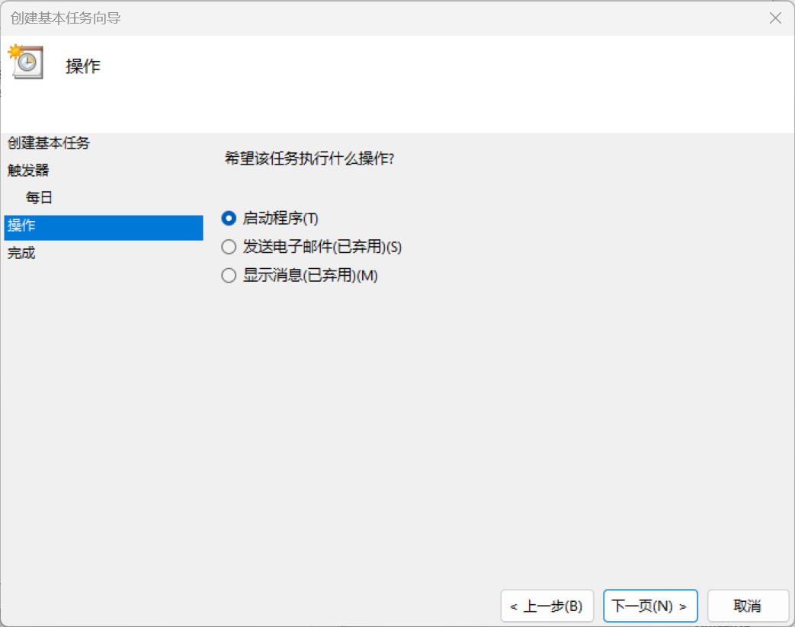
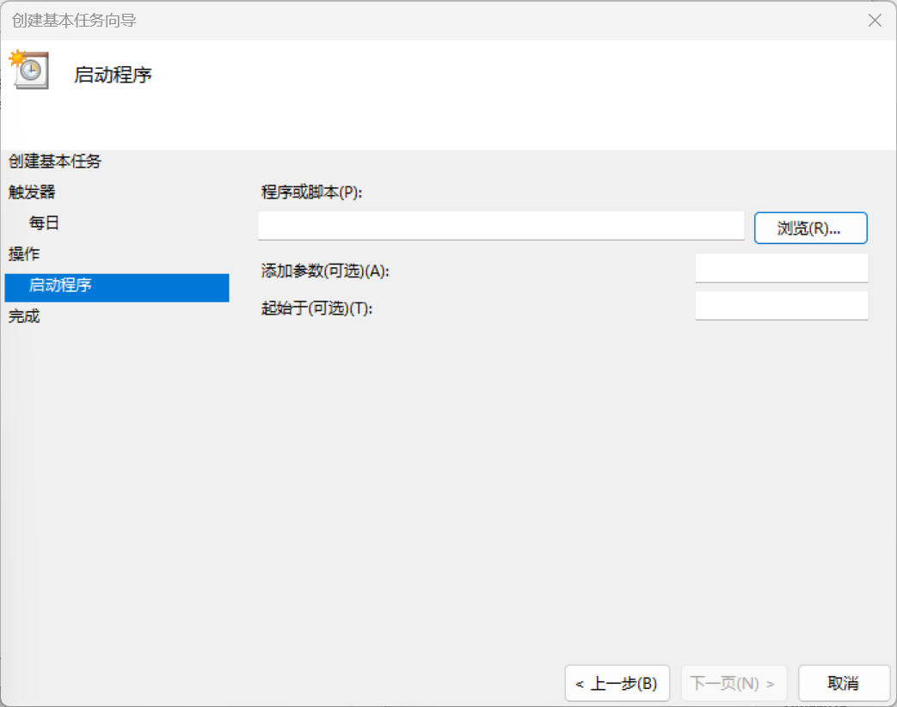

## Auto Backup (Windows) – README

### 1. Overview

- **English**:  
  This folder contains a small toolkit to automatically commit and push one or more local Git repositories to GitHub on Windows.  
  It is designed to be used together with Windows Task Scheduler for daily auto‑backup.

- **中文**：  
  该目录下包含一套在 Windows 上使用的自动备份工具，可以定时将一个或多个本地 Git 仓库自动提交并推送到 GitHub。  
  一般配合 Windows 的“任务计划程序”使用，实现每天自动备份。

---

### 2. File Structure 

- **`auto_backup_in_windows.bat`**
  - **EN**: Main batch script. Reads configuration at the top, loops through configured repositories, runs `git add/commit/push`, and (optionally) controls proxy via PowerShell.  
  - **ZH**：主批处理脚本。在文件开头读取配置，遍历所有配置好的仓库，执行 `git add/commit/push`，并可选地通过 PowerShell 控制代理。

- **`git_env.bat`**
  - **EN**: Local environment file that stores `GIT_USERNAME` and `GIT_PASSWORD` (GitHub PAT). It is ignored by Git via `.gitignore`.  
  
    **Note: This file needs tobe completed manually. You may refer to `git_env.bat.example`**
  - **ZH**：本地环境变量文件，保存 `GIT_USERNAME` 和 `GIT_PASSWORD`（GitHub PAT）。该文件已通过 `.gitignore` 忽略，不会被提交。
  
    **注意：该文件需要自己补充，可参考 `git_env.bat.example`**
  
- **`start_clash_proxy.ps1`**
  
  - **EN**: Example PowerShell script to control Clash (or similar proxy) via HTTP API. Used when `USE_PROXY=1`.  
  - **ZH**：用于通过 HTTP API 控制 Clash（或类似代理）的 PowerShell 示例脚本，当 `USE_PROXY=1` 时会被调用。
  
- **`assets/*.png`**
  - **EN**: Screenshots showing how to configure Windows Task Scheduler.  
  - **ZH**：演示如何在 Windows 任务计划程序中配置定时任务的截图。

---

### 3. Configuration 

#### 3.1 Configure `git_env.bat`

- **English**
  1. Open `git_env.bat`.
  2. Set your GitHub username and Personal Access Token (PAT):
     ```bat
     set "GIT_USERNAME=YourGitHubName"
     set "GIT_PASSWORD=your_github_pat"
     ```
  3. Make sure this file stays out of version control (already listed in `.gitignore`).

- **中文**
  1. 打开 `git_env.bat`。
  2. 设置你的 GitHub 用户名和 Personal Access Token（PAT）：
     ```bat
     set "GIT_USERNAME=你的GitHub用户名"
     set "GIT_PASSWORD=你的GitHub_PAT"
     ```
  3. 确保该文件不要被提交到仓库（项目已在 `.gitignore` 中忽略了它）。

---

#### 3.2 Configure `auto_backup_in_windows.bat`

在脚本顶部集中配置常用参数；以后换仓库、加仓库或修改分支只需要改这里。

- **English**
  - Main global options:
    - `COMMIT_PREFIX`: commit message prefix for all repositories.
    - `USE_PROXY`: set to `1` to enable proxy, `0` to disable.
    - `PROXY_SCRIPT`: path to the proxy controller PowerShell script.
  - Repository list:
    - `REPO_INDEXES`: a space‑separated list of repository indices, e.g. `1` or `1 2`.
    - For each index `N`:
      - `REPO_DIR_N`: local path to repo.
      - `GIT_BRANCH_N`: branch name (e.g. `main`).
      - `GITHUB_OWNER_N` / `GITHUB_REPO_N`: GitHub owner and repo name.

- **中文**
  - 全局配置示例：
    - `COMMIT_PREFIX`：所有仓库共享的提交信息前缀。
    - `USE_PROXY`：`1` 表示自动启用代理，`0` 表示关闭。
    - `PROXY_SCRIPT`：代理控制 PowerShell 脚本路径。
  - 仓库列表：
    - `REPO_INDEXES`：需要备份的仓库索引（空格分隔），例如 `1` 或 `1 2`。
    - 每个索引 `N`：
      - `REPO_DIR_N`：本地仓库路径。
      - `GIT_BRANCH_N`：分支名称（如 `main`）。
      - `GITHUB_OWNER_N` / `GITHUB_REPO_N`：GitHub 的 owner 和仓库名。

---

### 4. Run Manually / 手动运行

- **English**
  1. Open `cmd` or PowerShell.
  2. Run:
     ```bat
     cd /d D:\ProjectOfBZH\auto-backup\local-backup
     auto_backup_in_windows.bat
     ```
  3. Check the console output to confirm that commits and pushes work as expected.

- **中文**
  1. 打开 `cmd` 或 PowerShell。
  2. 执行：
     ```bat
     cd /d D:\ProjectOfBZH\auto-backup\local-backup
     auto_backup_in_windows.bat
     ```
  3. 查看控制台输出，确认提交和推送都正常。

---

### 5. Schedule with Windows Task Scheduler / 使用任务计划程序定时执行

下面以“每天凌晨 0 点自动备份”为例。

- **English steps**
  1. Open “Task Scheduler” from the Start menu.
  2. Create a **basic task** and give it a name (e.g. `Auto Git Backup`).
  3. Choose a **daily** trigger and set the time (e.g. 00:00).
  4. For **Action**, choose “Start a program”.
     - Program/script: `auto_backup_in_windows.bat` (or `cmd.exe` with appropriate arguments).
  5. Finish the wizard and test run the task once.

- **中文步骤**
  1. 在开始菜单中打开“任务计划程序”。
  2. 创建一个**基本任务**，命名为例如 `Auto Git Backup`。
  3. 选择**每天**触发，并设置时间（例如 00:00）。
  4. 在**操作**中选择“启动程序（Start a program）”：
     - “程序或脚本”栏选择你保存的 `auto_backup_in_windows.bat`，或使用 `cmd.exe` 搭配参数。
  5. 完成向导，并手动运行一次任务进行测试。


对应的界面可参考下方截图（Screenshots for reference）：













---

### 6. Notes & Tips / 注意事项

- **English**
  - Do **not** commit `git_env.bat` to any public repo; it contains secrets.
  - Use a GitHub PAT instead of a raw password; can be set to limited scopes (`repo` only).
  - If the machine is a laptop, check Task Scheduler “Conditions” so that the job still runs on battery if needed.

- **中文**
  - **不要**将 `git_env.bat` 提交到任何公开仓库，因为其中包含密钥信息。
  - 推荐使用 GitHub PAT 而不是明文密码，并给 PAT 分配最小权限（如只勾 `repo`）。
  - 如果是笔记本电脑，请注意任务计划程序中的“条件”设置，必要时允许在电池电量模式下也运行任务。

